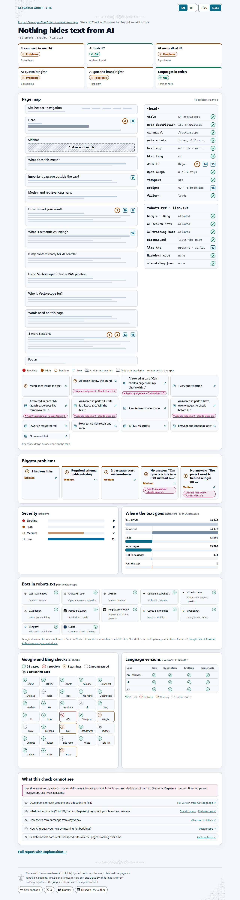
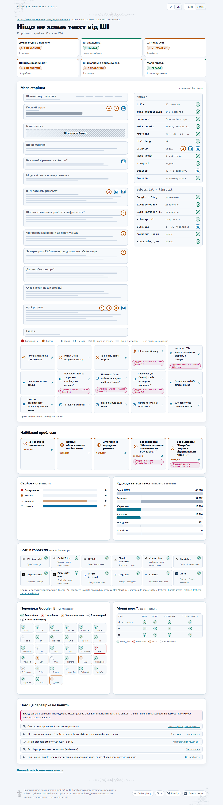
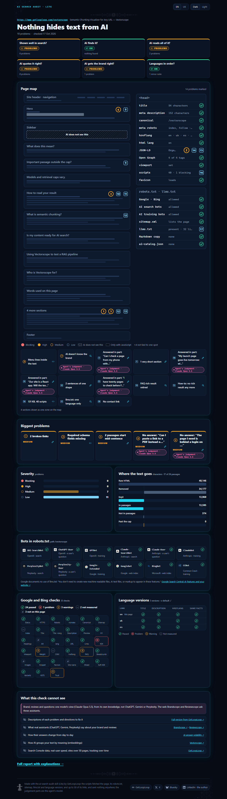
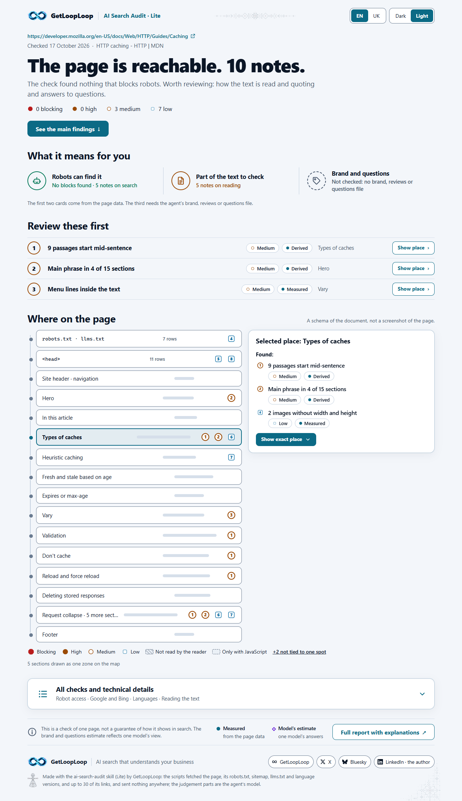
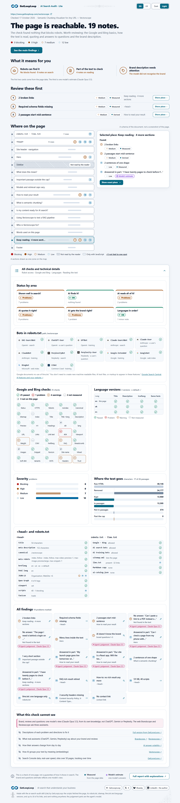

English · [Українська](README.uk.md)

# AI Search Audit Lite

AI Search Audit Lite **2.108**, an Agent Skill from [GetLoopLoop](https://www.getlooploop.com) for claude.ai and the Claude desktop app, Claude Code, Codex, opencode, Hermes Agent and other agents that load `SKILL.md` skills. Versions count in thousandths (2.101, 2.102, …), so the first number moves only on a breaking change.

Before Google, Bing or an AI assistant can show or quote a page, a crawler has to be allowed in, the page has to say what it is, and the text has to survive the machine's reading. `ai-search-audit` checks one public page against the standard, published rules for all three, adds three readings only an AI can make (the questions people ask, how the agent's own model describes the brand, and what it believes about the brand's reviews), and draws the result as one report: six status tiles, a map of the page built from its real document with every problem marked where it is, the biggest problems, the bots in robots.txt, the Google and Bing checklist, the language versions, and where the text goes on its way to an AI retriever.

Lite is a picture of the problems: each one is a short label, a severity and a place. It does not describe the problems or say how to fix them. A full version with explanations is available from [GetLoopLoop](https://www.getlooploop.com).



## What it checks

The scripts call no model and no embedding API. Every finding carries its layer: **measured** (a script counted it), **derived** (a fixed formula over measured values) or **agent's judgement** (written by the agent running the skill, into a JSON file the scripts validate, and badged in the report with the agent's model).

- **Access and indexing:** the HTTP status, the redirect chain, HTTPS and HSTS; robots.txt for Googlebot, Bingbot and the AI crawlers (the Vectorscope's RFC 9309 matching); meta robots and `X-Robots-Tag` noindex; snippet controls (`nosnippet`, `max-snippet:0`, `data-nosnippet` over the main text: Google requires a page to be "indexed and eligible to be shown in Google Search with a snippet" for AI features); whether the sitemap lists the page; llms.txt, with the note that Google documents no use of it; a Markdown copy of the page; `ai-catalog.json`; a declared IndexNow key file.
- **The Google and Bing checklist (35 cells):** title and description length, one h1, heading order, canonical, internal links, broken links (the first 30 checked, the rest counted), images (alt, width and height, lazy loading below the fold and not on the first image, modern formats, size from a HEAD of up to 20, srcset), viewport, html lang, Open Graph and Twitter tags, the favicon, the WebSite name, mixed content, a soft 404 (one path that cannot exist), the http, www and trailing-slash variants, page weight, a readable URL, hreflang pairs, FAQ and breadcrumb markup, and trust signals (an author on articles, About and Contact links, the organisation's name, logo and sameAs, a visible date that matches the markup, privacy and terms), link text that names nothing ("here", "read more"), #links with no target, nofollow on internal links, image links with no name and one alt on many images, an invalid html lang, the sitemap's lastmod dates and a Sitemap line in robots.txt, the preview image, and the HTML response's compression, Cache-Control and security headers.
- **Structured data:** JSON-LD parsed, required and recommended properties as Google's pages list them for FAQPage, Product, SoftwareApplication, BreadcrumbList, Event, JobPosting, LocalBusiness, VideoObject, QAPage, WebSite, ProductGroup, Offer, Review, AggregateRating, Article, Organization and Person, and retired rich results noted as informational with the date of [Google's entry](https://developers.google.com/search/updates) (FAQ, How-to, course info, ClaimReview, special announcement, estimated salary, vehicle listing, practice problem, the sitelinks search box).
- **AI reading:** the [Vectorscope](https://www.getlooploop.com/vectorscope) core (passages, the 26-passage cap, where the text goes), plus a hero lede lost with a removed `<header>`, headings in hidden panels, loading placeholders, words glued in the h1, navigation inside the text, thin sections, cut-off teasers and repeated claims. An empty single-page-app shell is detected and rendered in a local Chrome on its own, and the sections that exist only after JavaScript are drawn dashed on the map.
- **AI quotes it right:** FAQ markup against the visible text; **the questions people ask** (8 to 12 spoken questions the agent writes along the Voicescope's four axes, each judged complete, partial or missing against one passage, with a verbatim quote the script checks); **writing patterns** (the PatternScope's deterministic detectors: stock phrases, repeated sentence shapes, uniform openings, unchecked claims, with positions and a density per 1,000 words; signals, not an AI detector); **the target keyword** (`--keyword`, or one read off the h1: absent from title and h1, written two ways, confined to one section, most of the text off it, a promise with no figure).
- **AI gets the brand right:** the agent's model answers Brandscope's five buyer questions from its own knowledge (no browsing; "doesn't know" allowed), and the script compares them with the page: a price or a count the page states differently, a fact the page lacks, a brand the model does not know. For reviews, the model states its belief about the brand's rating on Reviewscope's 12 platforms and one invented control platform; a rating for the control is a hallucination, and a rating with no source on the page is flagged; ratings shown on the page without markup are measured. This is one model's view: the web [Brandscope](https://www.getlooploop.com/brandscope) and [Reviewscope](https://www.getlooploop.com/reviewscope) ask three assistants.
- **Languages:** the hreflang set (self-reference, x-default, valid codes), each alternate fetched to see whether it links back, titles and descriptions compared across versions, html lang against hreflang, and **the same facts**: the numbers in each h2 section compared across the versions, aligned by section order.

The same report in Ukrainian, and with the dark theme switched on:





MDN's HTTP caching guide fills all 26 passages; its last sections are merged into one zone on the map, and the links past the check's cap are counted. This run has no judgement files, so its brand card reads *not checked*:



Every technical detail sits in one closed section, *All checks and technical details*: the status by area, the bots in robots.txt, the 35 Google and Bing checks, the language versions, the severity chart, where the text goes, the `<head>` and robots.txt rows, every finding, and what the check cannot see:



## Examples

Real runs in [`examples/`](examples) (17 October 2026), each as HTML, Markdown and JSON; the judgement files are in [`examples/ai-search-audit-judgement/`](examples/ai-search-audit-judgement), written by Claude Code running Claude Opus 5.5, which did not know GetLoopLoop from its own knowledge and said so. The reports open in English; add `#lang=uk` to the address or press UK at the top for Ukrainian.

| Page | Problems | Blocking · high · medium · low | Among them |
|---|---|---|---|
| [getlooploop.com/vectorscope](examples/ai-search-audit-getlooploop-vectorscope.html) | 18 | 0 · 0 · 7 · 11 | two links to 404 pages, two questions no passage answers, the brand unknown to the model, How-to markup with no rich result any more |
| [getlooploop.com/uk/vectorscope](examples/ai-search-audit-getlooploop-vectorscope-uk.html) | 20 | 0 · 0 · 9 · 11 | the same, in Ukrainian; the keyword read off the h1 reaches 2 of 15 sections; the same facts in all three versions |
| [getlooploop.com/es/vectorscope](examples/ai-search-audit-getlooploop-vectorscope-es.html) | 17 | 0 · 0 · 7 · 10 | the same, in Spanish |
| [MDN: HTTP caching](examples/ai-search-audit-mdn-http-caching.html) | 10 | 0 · 0 · 3 · 7 | 6 passages start mid-sentence, images without width and height, no Organization markup (no judgement files) |
| [example.com](examples/ai-search-audit-example-com.html) | 22 | 0 · 0 · 6 · 16 | no h1; http and www variants that do not redirect; three questions with no answer; RFC 2606 and IANA, which the model knows and the page does not say |

## Install

The skill needs Node 20.18 or later (what cheerio declares) and **no `npm install`**: `dist/read.mjs` and `dist/audit.mjs` are the scripts bundled with everything they need, the Vectorscope's code and [cheerio](https://cheerio.js.org/) included, so plain `node` runs them, including in sandboxes that block package installs. The readable source is in `scripts/`; `dist/` is generated from it (see *Working on the skill*).

### One command (Claude Code, Codex, opencode and other agents)

```
npx skills add Olexan-art/ai-search-audit --skill ai-search-audit
```

The [skills CLI](https://skills.sh) asks which agents to install it for (add `-g` for every project, `-a claude-code` to pick one). Then ask your agent for "an AI search audit of <url>".

### claude.ai and the Claude desktop app

1. Download **`ai-search-audit.zip`** from this repository's [Releases](https://github.com/Olexan-art/ai-search-audit/releases). Do not unpack it: the upload takes the zip, with the `ai-search-audit` folder at its top level.
2. Turn on code execution: **Settings > Capabilities > Code execution and file creation**. Skills need it. On Team and Enterprise plans an owner controls it in Organization settings > Capabilities.
3. Upload the skill: **Customize > Skills**, the **+** button, **Create skill**, **Upload a skill**, then choose `ai-search-audit.zip`. Turn the skill on in the list. In the desktop app it is the same Customize > Skills page.
4. Let the sandbox reach the site you want audited. A run fetches the page, its `robots.txt`, its sitemap and a few more URLs on the same site (see *Network* below), and code execution only reaches what its network setting allows. On Free, Pro and Max plans that setting is **Allow network egress** in Settings > Capabilities. On Team and Enterprise plans an owner chooses in Organization settings > Capabilities: off, package managers only (the default), package managers and specific domains, or all domains. With specific domains, add the site's domain. If your plan's setting cannot allow the site, the run stops with `REFUSED unreachable` and says so; use Claude Code or another agent on your own machine for that page.
5. In a chat, ask: **"an AI search audit of https://example.com/page"**. Claude runs the scripts in the sandbox and hands you `report.html` as a file to download and open in your browser, with a short summary in the chat.

**Pasting this repository's link into a chat is not installing it.** Claude rightly will not download and run code from a link someone pasted, so it will at best imitate the steps by hand, and those findings are not the tool's. Upload the zip as above.

Sources: [Use skills in Claude](https://support.claude.com/en/articles/12512180-use-skills-in-claude) · [Create custom skills](https://claude.com/docs/skills/how-to) (the zip's structure, the name and description rules) · [Create and edit files with Claude](https://support.claude.com/en/articles/12111783-create-and-edit-files-with-claude) (code execution and network egress) · [Agent Skills overview](https://platform.claude.com/docs/en/agents-and-tools/agent-skills/overview) (network access by surface). Checked on 2026-10-16.

### No internet in the agent's shell

Cloud sandboxes often run the shell offline or keep the skills folder read-only. The skill does not need a skills folder: unpack `ai-search-audit.zip` anywhere the agent can write and point it at that folder (or attach the zip to the chat). With no network, save the page in your browser as "Web page, HTML only" and, if you can, its `robots.txt`, and give both files to the agent: the skill reads the saved copy and marks every check that needs the network as not checked.

## Use it with your agent

The skill is one folder, `skills/ai-search-audit`, with a `SKILL.md` and Node scripts. Agents that support Agent Skills load it from their skills directory; any other agent can follow `SKILL.md` as instructions. Either way the agent runs the same scripts from the skill folder, and the agent's own model writes the judgement files. No install step: the agent runs `node dist/read.mjs` and `node dist/audit.mjs` as they are.

```
git clone https://github.com/Olexan-art/ai-search-audit.git
```

**Claude Code** loads personal skills from `~/.claude/skills/` and project skills from `.claude/skills/`.

```
mkdir -p ~/.claude/skills && cp -r ai-search-audit/skills/ai-search-audit ~/.claude/skills/ai-search-audit   # personal
mkdir -p .claude/skills && cp -r ai-search-audit/skills/ai-search-audit .claude/skills/ai-search-audit       # or: this project only
```

```powershell
New-Item -ItemType Directory -Force "$HOME\.claude\skills" | Out-Null
Copy-Item -Recurse ai-search-audit\skills\ai-search-audit "$HOME\.claude\skills\ai-search-audit"
```

**OpenAI Codex (CLI, IDE extension, app)** scans `$HOME/.agents/skills` (user) and `.agents/skills` in every directory from where you launch it up to the repository root (repo).

```
mkdir -p ~/.agents/skills && cp -r ai-search-audit/skills/ai-search-audit ~/.agents/skills/ai-search-audit
```

```powershell
New-Item -ItemType Directory -Force "$HOME\.agents\skills" | Out-Null
Copy-Item -Recurse ai-search-audit\skills\ai-search-audit "$HOME\.agents\skills\ai-search-audit"
```

**opencode** loads global skills from `~/.config/opencode/skills/`, `~/.claude/skills/` or `~/.agents/skills/`, and project skills from `.opencode/skills/`, `.claude/skills/` or `.agents/skills/` (walking up to the git worktree). A copy made for Claude Code or Codex above is picked up too; otherwise:

```
mkdir -p ~/.config/opencode/skills && cp -r ai-search-audit/skills/ai-search-audit ~/.config/opencode/skills/ai-search-audit
```

**Hermes Agent (Nous Research)** keeps skills in `~/.hermes/skills/`. It also reads `<project>/.hermes/skills/` and `<project>/.agents/skills/` once you trust the repository with `hermes skills trust`, and any folder listed under `skills.external_dirs` in `~/.hermes/config.yaml` (for example `~/.agents/skills`).

```
mkdir -p ~/.hermes/skills && cp -r ai-search-audit/skills/ai-search-audit ~/.hermes/skills/ai-search-audit
```

**GLM** (Zhipu / Z.ai) is a model family, not an agent. Z.ai's GLM Coding Plan is used inside coding agents; its documentation names Claude Code, Codex and OpenCode among them. Install the skill for the agent you run GLM in, as above: the skill then follows that agent's instructions, and GLM writes the judgement files.

**Any other agent:** point its instructions file (for example `AGENTS.md`) at the skill, so it reads the steps before it starts:

```
For an SEO or AI search audit of a web page, follow skills/ai-search-audit/SKILL.md and run its scripts from that folder.
```

Sources: [Claude Code skills](https://code.claude.com/docs/en/skills) · [Codex skills](https://learn.chatgpt.com/docs/build-skills) (where developers.openai.com/codex/skills now redirects) · [opencode skills](https://opencode.ai/docs/skills) · [Hermes Agent skills](https://hermes-agent.nousresearch.com/docs/user-guide/features/skills) · [Z.ai GLM Coding Plan](https://docs.z.ai/devpack/overview). Checked on 2026-10-16; skill folders move between releases, so check your agent's current docs if a path does not work.

## A run, in short

```
node dist/read.mjs https://example.com/page --out reading.json
# the agent writes questions.json, brand.json and reviews.json (schemas in SKILL.md)
node dist/audit.mjs reading.json --questions questions.json --brand brand.json --reviews reviews.json --check
node dist/audit.mjs reading.json --questions questions.json --brand brand.json --reviews reviews.json --html report.html --md report.md --json export.json
```

**Network:** the page, its site's `/robots.txt`, its sitemap (up to 5 child sitemaps), `/llms.txt`, up to 10 hreflang alternates, a HEAD (or a bodiless GET) of up to 30 links and up to 20 images, and one request each for the favicon, a path that does not exist, up to 3 URL variants, a Markdown copy, `ai-catalog.json` and a declared IndexNow key, plus one DNS lookup of the host and one RDAP request to rdap.org with the site's IP address; every cap is reported, never silent. **Outputs:** a self-contained `report.html` (EN | UK, light by default with a dark theme on the toggle, no network requests, every piece of page text escaped), `report.md`, and `export.json` (`getlooploop/ai-search-audit@1`), which carries every finding with its layer, its evidence and the rules it rests on.

### This skill's own thresholds

Where no published rule gives a number: a title of 10 to 60 characters; a description of 70 to 160; a redirect chain from 2 hops; a heavy page over 500 KB of HTML or 30 scripts; a hard-to-read URL over 115 characters, with more than 2 query parameters or a session id; hidden headings counted high from 200 hidden characters; an image over 200 KB, and a srcset expected over 100 KB or from 800 px; above the fold as the hero and its first two images; `data-nosnippet` over half the visible text; an app shell under 150 words; stock phrases medium from 2.0 per 1,000 words; a keyword that misses half the passage text or reaches a third of the sections or fewer. Each is a named constant in `skills/ai-search-audit/scripts/lib/` with its reason.

## What it cannot see

- **Field data and the index.** Core Web Vitals and "in Google's index" are always *not measured*: they need real-user data and Search Console, which a script on one page does not have.
- **What assistants answer today.** The brand and review readings are one model's knowledge at its training time. They are not a measurement of any assistant and say nothing about what ChatGPT, Gemini or Perplexity answer now.
- **Pages behind a login.** One public URL per audit, no cookies and no login. The guard refuses localhost, private and link-local addresses, hostnames without a dot, non-standard ports and anything that is not http(s), on every redirect hop (5 at most).
- **Language picked by location.** No Accept-Language is sent, so a site that chooses a language by where the request comes from may answer in another one.
- **JavaScript, unless asked.** The reading takes the HTML as served. `--render`, or an empty app shell, also runs the page in a local Chrome, Chromium or Edge; with no browser, the report says the render was not done.
- **Everything past a cap.** 30 links and 20 images are checked, 10 language versions read, 5 child sitemaps opened; 12 seconds per request (8 for a link, an image or a site check), 3,000,000 characters of HTML. Every cap is named in the report, never applied silently.
- **How to fix it.** Lite lists problems; it does not explain them or propose fixes.

## Working on the skill

`scripts/` is the source; `dist/` is built from it with [esbuild](https://esbuild.github.io/) (a development dependency only) and committed, so the skill runs without an install.

```
cd skills/ai-search-audit
npm install          # cheerio, and esbuild for the build
npm run build        # scripts/ → dist/read.mjs, dist/audit.mjs (not minified, readable)
npm test             # includes a check that dist/ equals a fresh build, so dist never drifts from scripts/
npm run zip          # dist-release/ai-search-audit.zip, the file to attach to a release for claude.ai
```

Change `scripts/`, run `npm run build`, and commit both.

The reading, the robots.txt rules, the passage checks and the language detection are the Vectorscope skill's code, vendored unchanged in [`skills/ai-search-audit/scripts/vendor/vectorscope/`](skills/ai-search-audit/scripts/vendor/vectorscope/VENDORED.md), which records the source commit and version. To update it, change it in getlooploop-skills, then copy it again from a checkout: `node tools/sync-vectorscope.mjs <path to getlooploop-skills>`, followed by `npm run build && npm test`.

## Related

- [getlooploop-skills](https://github.com/Olexan-art/getlooploop-skills): the Vectorscope skill, which shows how an AI retriever reads a page passage by passage, and compares 2 to 5 pages. This skill's AI reading is its code.
- [GetLoopLoop](https://www.getlooploop.com) and the web [Vectorscope](https://www.getlooploop.com/vectorscope).

## Licence

Free to use, change and share under the MIT licence, see [LICENSE](LICENSE). If you publish something built with it, a link to [getlooploop.com](https://www.getlooploop.com) is appreciated.
