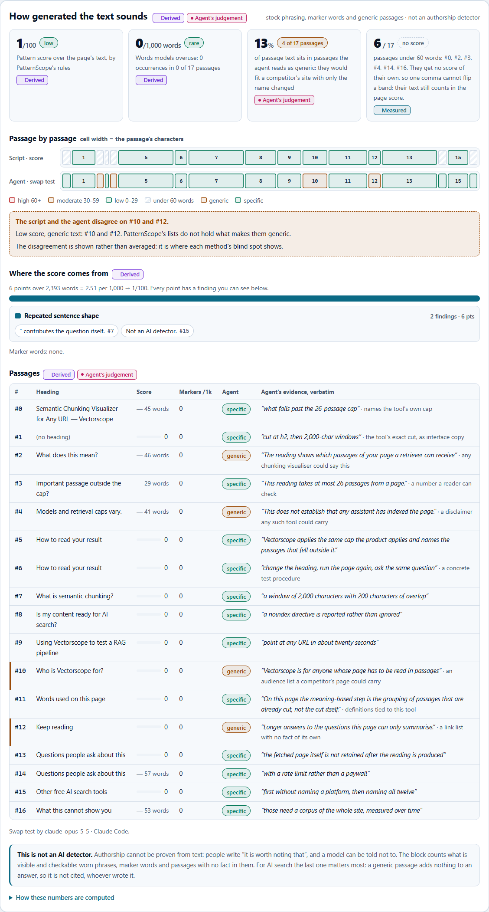
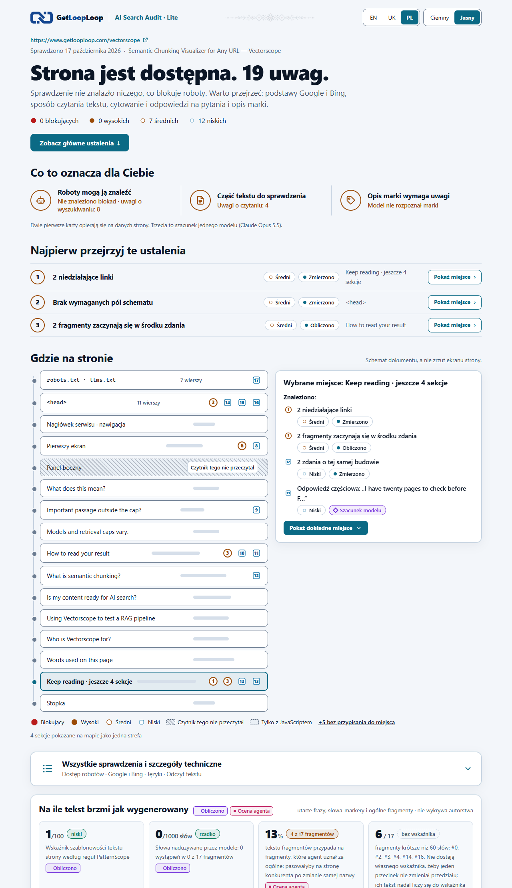

[English](README.md) · [Українська](README.uk.md) · Polski

# AI Search Audit Lite

AI Search Audit Lite **2.109** to skill (Agent Skill) od [GetLoopLoop](https://www.getlooploop.com) dla claude.ai i aplikacji Claude na komputer, Claude Code, Codex, opencode, Hermes Agent i innych agentów, które wczytują skille w formacie `SKILL.md`. Wersje liczymy w tysięcznych (2.101, 2.102, …), więc pierwsza cyfra zmienia się tylko przy zmianie niezgodnej wstecz.

Zanim Google, Bing albo asystent AI pokaże lub zacytuje stronę, robot musi zostać wpuszczony, strona musi powiedzieć, czym jest, a tekst musi przetrwać maszynowe czytanie. `ai-search-audit` sprawdza jedną publiczną stronę według standardowych, opublikowanych reguł dla wszystkich trzech etapów, dodaje trzy odczyty, które może zrobić tylko AI (pytania, które zadają ludzie, jak własny model agenta opisuje markę i co sądzi o jej opiniach), i przedstawia wynik w jednym raporcie: sześć kafelków stanu, mapa strony zbudowana z jej prawdziwego dokumentu, na której każdy problem zaznaczono w jego miejscu, największe problemy, boty w robots.txt, lista kontrolna Google i Bing, wersje językowe, droga tekstu do retrievera AI, a na samym dole: na ile tekst brzmi jak wygenerowany. Raport można czytać po angielsku, ukraińsku lub polsku.

Lite to obraz problemów: każdy ma krótką etykietę, poziom ważności i miejsce. Nie opisuje problemów i nie mówi, jak je naprawić. Pełna wersja z wyjaśnieniami jest dostępna w [GetLoopLoop](https://www.getlooploop.com).


## Co sprawdza

Skrypty nie wywołują żadnego modelu ani API embeddingów. Każde ustalenie ma swoją warstwę: **Zmierzono** (policzył skrypt), **Obliczono** (stały wzór na zmierzonych wartościach) albo **Ocena agenta** (zapisana przez agenta, który uruchamia skill, w pliku JSON sprawdzanym przez skrypty, i oznaczona w raporcie nazwą modelu agenta).

- **Dostęp i indeksowanie:** status HTTP, łańcuch przekierowań, HTTPS i HSTS; robots.txt dla Googlebota, Bingbota i robotów AI (dopasowanie według RFC 9309 z Vectorscope); noindex w meta robots i `X-Robots-Tag`; sterowanie fragmentami w wynikach (`nosnippet`, `max-snippet:0`, `data-nosnippet` nad głównym tekstem: Google wymaga, by strona była „indexed and eligible to be shown in Google Search with a snippet”, aby trafić do funkcji AI); czy sitemap zawiera stronę; llms.txt, z uwagą, że Google nie dokumentuje żadnego jego użycia; kopia strony w Markdownie; `ai-catalog.json`; plik zadeklarowanego klucza IndexNow.
- **Lista kontrolna Google i Bing (35 pól):** długość title i opisu, jeden h1, kolejność nagłówków, canonical, linki wewnętrzne, niedziałające linki (pierwsze 30 sprawdzone, reszta policzona), obrazy (alt, width i height, lazy loading poniżej pierwszego ekranu i nie na pierwszym obrazie, nowoczesne formaty, rozmiar z żądania HEAD dla maksymalnie 20 obrazów, srcset), viewport, html lang, tagi Open Graph i Twitter, favicon, nazwa WebSite, treści mieszane, soft 404 (jedna ścieżka, która nie może istnieć), warianty adresu z http, www i ukośnikiem na końcu, waga strony, czytelny adres URL, pary hreflang, znaczniki FAQ i okruszków, a także sygnały zaufania (autor przy artykułach, linki „O nas” i „Kontakt”, nazwa, logo i sameAs organizacji, widoczna data zgodna ze znacznikami, polityka prywatności i regulamin), tekst linku, który niczego nie nazywa („tutaj”, „czytaj więcej”), linki # bez celu, nofollow na linkach wewnętrznych, linki-obrazy bez nazwy i ten sam alt na wielu obrazach, nieprawidłowy html lang, daty lastmod w sitemapie i wiersz Sitemap w robots.txt, obraz podglądu oraz kompresja, Cache-Control i nagłówki bezpieczeństwa w odpowiedzi HTML.
- **Dane strukturalne:** parsowanie JSON-LD, właściwości wymagane i zalecane, tak jak wymieniają je strony Google, dla FAQPage, Product, SoftwareApplication, BreadcrumbList, Event, JobPosting, LocalBusiness, VideoObject, QAPage, WebSite, ProductGroup, Offer, Review, AggregateRating, Article, Organization i Person; wycofane wyniki rozszerzone oznaczone jako informacyjne, z datą [wpisu Google](https://developers.google.com/search/updates) (FAQ, How-to, course info, ClaimReview, special announcement, estimated salary, vehicle listing, practice problem, pole wyszukiwania w sitelinkach).
- **Czytanie przez AI:** rdzeń [Vectorscope](https://www.getlooploop.com/vectorscope) (fragmenty, limit 26 fragmentów, dokąd trafia tekst), a do tego lead z sekcji hero utracony razem z usuniętym `<header>`, nagłówki w ukrytych panelach, napisy ładowania, sklejone słowa w h1, nawigacja w środku tekstu, zbyt cienkie sekcje, ucięte zapowiedzi i powtórzone twierdzenia. Pustą powłokę aplikacji jednostronicowej skill rozpoznaje i sam renderuje w lokalnym Chrome, a sekcje, które istnieją dopiero po JavaScripcie, rysuje na mapie przerywaną linią.
- **AI cytuje poprawnie:** znaczniki FAQ a widoczny tekst; **pytania, które zadają ludzie** (od 8 do 12 pytań w formie mówionej, które agent pisze według czterech osi Voicescope; każde oceniane jako odpowiedź pełna, częściowa lub brakująca w jednym fragmencie, z dosłownym cytatem, który sprawdza skrypt); **schematy pisania** (deterministyczne detektory PatternScope: utarte frazy, powtarzające się budowy zdań, jednakowe początki, niesprawdzone twierdzenia, z pozycjami i gęstością na 1000 słów; to sygnały, a nie detektor AI); **docelowa fraza kluczowa** (`--keyword` albo odczytana z h1: brak w title i h1, zapisana na dwa sposoby, zamknięta w jednej sekcji, większość tekstu bez niej, obietnica bez liczby).
- **AI dobrze opisuje markę:** model agenta odpowiada na pięć pytań kupującego z Brandscope na podstawie własnej wiedzy (bez przeglądania sieci; „nie wiem” jest dozwolone), a skrypt porównuje odpowiedzi ze stroną: cena lub liczba, którą strona podaje inaczej, fakt, którego na stronie brakuje, marka, której model nie zna. W przypadku opinii model podaje, jaką ocenę marki jego zdaniem ma ona na 12 platformach Reviewscope i na jednej wymyślonej platformie kontrolnej; ocena dla platformy kontrolnej to halucynacja, a ocena bez źródła na stronie jest oznaczana; oceny pokazane na stronie bez znaczników są mierzone. To punkt widzenia jednego modelu: webowe [Brandscope](https://www.getlooploop.com/brandscope) i [Reviewscope](https://www.getlooploop.com/reviewscope) pytają trzech asystentów.
- **Na ile tekst brzmi jak wygenerowany** (2.109, na dole raportu, ten sam blok co w [skillu Vectorscope](https://github.com/Olexan-art/getlooploop-skills)): wskaźnik szablonowości ze schematów pisania, obok niego policzone słowa, których modele językowe nadużywają, oraz test podmiany od agenta, czyli plik `style.json` z jednym werdyktem na każdy fragment: konkretny albo na tyle ogólny, że mógłby stać na stronie konkurenta po zmianie samej nazwy, a przy każdym dosłowny cytat, który sprawdza skrypt. Fragment po fragmencie, ustalenia stojące za każdym punktem, a tam, gdzie skrypt i agent się nie zgadzają, oba zdania. Blok nie wykrywa autorstwa i mówi to wprost.
- **Języki:** zestaw hreflang (odwołanie do siebie, x-default, poprawne kody), każda wersja alternatywna pobrana, by sprawdzić, czy linkuje z powrotem, title i opisy porównane między wersjami, html lang a hreflang oraz **te same fakty**: liczby w każdej sekcji h2 porównane między wersjami, zestawionymi według kolejności sekcji.

Na ile tekst brzmi jak wygenerowany, na dole raportu:



Ten sam raport po ukraińsku, po polsku i z włączonym ciemnym motywem:





Przewodnik MDN o buforowaniu HTTP wypełnia wszystkie 26 fragmentów; jego ostatnie sekcje są na mapie połączone w jedną strefę, a linki ponad limit sprawdzania zostały policzone. W tym przebiegu jedynym plikiem ocen jest test podmiany, więc karta marki pokazuje *nie sprawdzono*:


Wszystkie szczegóły techniczne są w jednej zwiniętej sekcji, *Wszystkie testy i szczegóły techniczne*: stan według obszarów, boty w robots.txt, 35 testów Google i Bing, wersje językowe, wykres ważności, dokąd trafia tekst, wiersze `<head>` i robots.txt, wszystkie ustalenia oraz to, czego test nie widzi:


## Przykłady

Prawdziwe przebiegi w [`examples/`](examples), każdy jako HTML, Markdown i JSON. Trzy strony getlooploop.com odczytano 17 października 2026 (te same odczyty co w przykładzie pełnego skilla) i ponownie zbadano 18 października wersją 2.109; MDN i example.com odczytano 18 października. Pliki ocen są w [`examples/ai-search-audit-judgement/`](examples/ai-search-audit-judgement); napisał je Claude Code z modelem Claude Opus 5.5, który nie znał GetLoopLoop z własnej wiedzy i tak powiedział. Raporty otwierają się po angielsku; dodaj do adresu `#lang=uk` lub `#lang=pl` albo kliknij UK lub PL na górze.

| Strona | Problemy | Blokujące · wysokie · średnie · niskie | Na ile brzmi jak wygenerowany | Wśród nich |
|---|---|---|---|---|
| [getlooploop.com/vectorscope](examples/ai-search-audit-getlooploop-vectorscope.html) | 19 | 0 · 0 · 7 · 12 | wskaźnik 1, brak słów-markerów, 4 z 17 fragmentów ogólne | dwa linki do stron 404, dwa pytania bez odpowiedzi w żadnym fragmencie, marka nieznana modelowi, znaczniki How-to, które nie dają już wyniku rozszerzonego |
| [getlooploop.com/uk/vectorscope](examples/ai-search-audit-getlooploop-vectorscope-uk.html) | 21 | 0 · 0 · 8 · 13 | wskaźnik 2, brak słów-markerów, 4 z 17 ogólne | to samo po ukraińsku; fraza kluczowa odczytana z h1 pojawia się w 2 z 15 sekcji; te same fakty we wszystkich trzech wersjach |
| [getlooploop.com/es/vectorscope](examples/ai-search-audit-getlooploop-vectorscope-es.html) | 18 | 0 · 0 · 7 · 11 | wskaźnik 0, brak słów-markerów, 5 z 18 ogólnych | to samo po hiszpańsku |
| [MDN: HTTP caching](examples/ai-search-audit-mdn-http-caching.html) | 10 | 0 · 0 · 3 · 7 | wskaźnik 0, 0,2 słowa-markera na 1000 słów, 5 z 26 ogólnych (wstęp, stopka, listy linków) | 6 fragmentów zaczyna się w środku zdania, obrazy bez width i height, brak znaczników Organization (z ocen tylko test podmiany) |
| [example.com](examples/ai-search-audit-example-com.html) | 24 | 0 · 0 · 6 · 18 | brak wskaźnika (poniżej 60 słów), 1 z 2 ogólny | brak h1; warianty z http i www bez przekierowania; trzy pytania bez odpowiedzi; RFC 2606 i IANA, które model zna, a strona o nich nie mówi |

## Instalacja

Skill wymaga Node 20.18 lub nowszego (tego wymaga cheerio) i **nie wymaga `npm install`**: `dist/read.mjs` i `dist/audit.mjs` to skrypty spakowane razem ze wszystkim, czego potrzebują, w tym z kodem Vectorscope i [cheerio](https://cheerio.js.org/), więc uruchamia je zwykły `node`, także w piaskownicach, które blokują instalowanie pakietów. Czytelny kod źródłowy jest w `scripts/`; `dist/` jest z niego generowany (zob. *Praca nad skillem*).

### Jednym poleceniem (Claude Code, Codex, opencode i inne agenty)

```
npx skills add Olexan-art/ai-search-audit --skill ai-search-audit
```

[Narzędzie skills](https://skills.sh) zapyta, dla których agentów zainstalować skill (dodaj `-g`, by działał we wszystkich projektach, albo `-a claude-code`, by wybrać jednego agenta). Potem poproś agenta: „zrób audyt AI search strony <adres>”.

### claude.ai i aplikacja Claude na komputer

1. Pobierz **`ai-search-audit.zip`** z sekcji [Releases](https://github.com/Olexan-art/ai-search-audit/releases) tego repozytorium. Nie rozpakowuj go: przesyła się sam plik zip, z folderem `ai-search-audit` na najwyższym poziomie.
2. Włącz wykonywanie kodu: **Settings > Capabilities > Code execution and file creation**. Skille go potrzebują. W planach Team i Enterprise kontroluje to właściciel w Organization settings > Capabilities.
3. Prześlij skill: **Customize > Skills**, przycisk **+**, **Create skill**, **Upload a skill**, a potem wybierz `ai-search-audit.zip`. Włącz skill na liście. W aplikacji na komputer to ta sama strona Customize > Skills.
4. Pozwól piaskownicy łączyć się ze stroną, którą chcesz zbadać. Przebieg pobiera stronę, jej `robots.txt`, sitemap i kilka innych adresów w tej samej witrynie (zob. *Sieć* niżej), a wykonywanie kodu sięga tylko tam, gdzie pozwala jego ustawienie sieci. W planach Free, Pro i Max to ustawienie **Allow network egress** w Settings > Capabilities. W planach Team i Enterprise wybiera właściciel w Organization settings > Capabilities: wyłączone, tylko menedżery pakietów (domyślnie), menedżery pakietów i wybrane domeny albo wszystkie domeny. Przy wybranych domenach dodaj domenę witryny. Jeśli ustawienie Twojego planu nie pozwala na tę witrynę, przebieg zatrzyma się z `REFUSED unreachable` i to powie; dla takiej strony użyj Claude Code lub innego agenta na własnym komputerze.
5. Na czacie poproś: **„zrób audyt AI search strony https://example.com/page”**. Claude uruchomi skrypty w piaskownicy i przekaże Ci `report.html` jako plik do pobrania i otwarcia w przeglądarce, a na czacie napisze krótkie podsumowanie.

**Wklejenie linku do tego repozytorium na czacie to nie instalacja.** Claude słusznie nie pobierze i nie uruchomi kodu z linku, który ktoś wkleił, więc w najlepszym razie odtworzy kroki ręcznie, a takie ustalenia nie pochodzą z narzędzia. Prześlij plik zip, jak opisano wyżej.

Źródła: [Use skills in Claude](https://support.claude.com/en/articles/12512180-use-skills-in-claude) · [Create custom skills](https://claude.com/docs/skills/how-to) (struktura pliku zip, zasady dla nazwy i opisu) · [Create and edit files with Claude](https://support.claude.com/en/articles/12111783-create-and-edit-files-with-claude) (wykonywanie kodu i dostęp do sieci) · [Agent Skills overview](https://platform.claude.com/docs/en/agents-and-tools/agent-skills/overview) (dostęp do sieci w poszczególnych środowiskach). Sprawdzono 16.10.2026.

### Bez internetu w powłoce agenta

Piaskownice w chmurze często uruchamiają powłokę bez sieci albo nie pozwalają zapisywać w folderze skilli. Skill nie potrzebuje folderu skilli: rozpakuj `ai-search-audit.zip` w dowolnym miejscu, w którym agent może zapisywać, i wskaż mu ten folder (albo dołącz plik zip na czacie). Bez sieci zapisz stronę w przeglądarce jako „Strona internetowa, tylko HTML” i, jeśli możesz, jej `robots.txt`, a potem przekaż oba pliki agentowi: skill odczyta zapisaną kopię i oznaczy każdy test, który wymaga sieci, jako niesprawdzony.

## Używanie z Twoim agentem

Skill to jeden folder, `skills/ai-search-audit`, z plikiem `SKILL.md` i skryptami w Node. Agenty obsługujące Agent Skills wczytują go ze swojego folderu skilli; każdy inny agent może wykonać `SKILL.md` jako instrukcję. W obu przypadkach agent uruchamia te same skrypty z folderu skilla, a pliki ocen pisze model samego agenta. Nic nie trzeba instalować: agent uruchamia `node dist/read.mjs` i `node dist/audit.mjs` bez zmian.

```
git clone https://github.com/Olexan-art/ai-search-audit.git
```

**Claude Code** wczytuje osobiste skille z `~/.claude/skills/`, a skille projektu z `.claude/skills/`.

```
mkdir -p ~/.claude/skills && cp -r ai-search-audit/skills/ai-search-audit ~/.claude/skills/ai-search-audit   # osobiście
mkdir -p .claude/skills && cp -r ai-search-audit/skills/ai-search-audit .claude/skills/ai-search-audit       # albo: tylko ten projekt
```

```powershell
New-Item -ItemType Directory -Force "$HOME\.claude\skills" | Out-Null
Copy-Item -Recurse ai-search-audit\skills\ai-search-audit "$HOME\.claude\skills\ai-search-audit"
```

**OpenAI Codex (CLI, rozszerzenie IDE, aplikacja)** przeszukuje `$HOME/.agents/skills` (poziom użytkownika) i `.agents/skills` w każdym folderze od miejsca uruchomienia aż do katalogu głównego repozytorium (poziom repozytorium).

```
mkdir -p ~/.agents/skills && cp -r ai-search-audit/skills/ai-search-audit ~/.agents/skills/ai-search-audit
```

```powershell
New-Item -ItemType Directory -Force "$HOME\.agents\skills" | Out-Null
Copy-Item -Recurse ai-search-audit\skills\ai-search-audit "$HOME\.agents\skills\ai-search-audit"
```

**opencode** wczytuje globalne skille z `~/.config/opencode/skills/`, `~/.claude/skills/` lub `~/.agents/skills/`, a skille projektu z `.opencode/skills/`, `.claude/skills/` lub `.agents/skills/` (idąc w górę aż do katalogu głównego git). Kopię zrobioną wyżej dla Claude Code lub Codex też znajdzie; w przeciwnym razie:

```
mkdir -p ~/.config/opencode/skills && cp -r ai-search-audit/skills/ai-search-audit ~/.config/opencode/skills/ai-search-audit
```

**Hermes Agent (Nous Research)** trzyma skille w `~/.hermes/skills/`. Czyta też `<project>/.hermes/skills/` i `<project>/.agents/skills/`, gdy oznaczysz repozytorium jako zaufane poleceniem `hermes skills trust`, oraz każdy folder wymieniony w `skills.external_dirs` w `~/.hermes/config.yaml` (na przykład `~/.agents/skills`).

```
mkdir -p ~/.hermes/skills && cp -r ai-search-audit/skills/ai-search-audit ~/.hermes/skills/ai-search-audit
```

**GLM** (Zhipu / Z.ai) to rodzina modeli, a nie agent. GLM Coding Plan od Z.ai jest używany wewnątrz agentów do programowania; jego dokumentacja wymienia wśród nich Claude Code, Codex i OpenCode. Zainstaluj skill dla agenta, w którym używasz GLM, jak opisano wyżej: skill działa wtedy według instrukcji tego agenta, a pliki ocen pisze GLM.

**Każdy inny agent:** wskaż skill w jego pliku instrukcji (na przykład `AGENTS.md`), żeby przeczytał kroki, zanim zacznie:

```
For an SEO or AI search audit of a web page, follow skills/ai-search-audit/SKILL.md and run its scripts from that folder.
```

Źródła: [skille Claude Code](https://code.claude.com/docs/en/skills) · [skille Codex](https://learn.chatgpt.com/docs/build-skills) (tu przekierowuje teraz developers.openai.com/codex/skills) · [skille opencode](https://opencode.ai/docs/skills) · [skille Hermes Agent](https://hermes-agent.nousresearch.com/docs/user-guide/features/skills) · [GLM Coding Plan od Z.ai](https://docs.z.ai/devpack/overview). Sprawdzono 16.10.2026; foldery skilli zmieniają się między wydaniami, więc jeśli ścieżka nie działa, sprawdź aktualną dokumentację swojego agenta.

## Przebieg w skrócie

```
node dist/read.mjs https://example.com/page --out reading.json
# agent pisze questions.json, style.json, brand.json i reviews.json (schematy w references/judgement-files.md)
node dist/audit.mjs reading.json --questions questions.json --style style.json --brand brand.json --reviews reviews.json --check
node dist/audit.mjs reading.json --questions questions.json --style style.json --brand brand.json --reviews reviews.json --html report.html --md report.md --json export.json
```

**Sieć:** strona, `/robots.txt` jej witryny, jej sitemap (do 5 sitemap podrzędnych), `/llms.txt`, do 10 wersji alternatywnych hreflang, żądanie HEAD (lub GET bez treści) dla maksymalnie 30 linków i 20 obrazów oraz po jednym żądaniu dla favicony, ścieżki, która nie istnieje, maksymalnie 3 wariantów adresu, kopii w Markdownie, `ai-catalog.json` i zadeklarowanego klucza IndexNow, a do tego jedno zapytanie DNS o host i jedno żądanie RDAP do rdap.org z adresem IP witryny; każdy limit jest podawany w raporcie, żaden nie działa po cichu. **Wyniki:** samodzielny `report.html` (EN | UK | PL, domyślnie jasny, z ciemnym motywem na przełączniku, bez żądań sieciowych, każdy fragment tekstu strony zabezpieczony przez escapowanie), `report.md` oraz `export.json` (`getlooploop/ai-search-audit@1`), który zawiera każde ustalenie z jego warstwą, dowodami i regułami, na których się opiera.

### Własne progi tego skilla

Tam, gdzie żadna opublikowana reguła nie podaje liczby: title od 10 do 60 znaków; opis od 70 do 160; łańcuch przekierowań od 2 kroków; ciężka strona powyżej 500 KB HTML lub 30 skryptów; trudny do odczytania adres URL powyżej 115 znaków, z więcej niż 2 parametrami zapytania lub identyfikatorem sesji; ukryte nagłówki liczone jako wysokie od 200 ukrytych znaków; obraz powyżej 200 KB, a srcset oczekiwany powyżej 100 KB lub od 800 px; pierwszy ekran to sekcja hero i jej dwa pierwsze obrazy; `data-nosnippet` nad ponad połową widocznego tekstu; powłoka aplikacji poniżej 150 słów; utarte frazy jako średnie od 2,0 na 1000 słów; fraza kluczowa, której brakuje w połowie tekstu fragmentów albo która pojawia się w jednej trzeciej sekcji lub mniej. Każdy próg to nazwana stała w `skills/ai-search-audit/scripts/lib/` z uzasadnieniem.

## Czego nie widzi

- **Danych terenowych i indeksu.** Core Web Vitals i „w indeksie Google” mają zawsze status *nie zmierzono*: potrzebują danych od prawdziwych użytkowników i Search Console, których skrypt na jednej stronie nie ma.
- **Tego, co asystenci odpowiadają dziś.** Odczyty marki i opinii to wiedza jednego modelu z czasu jego treningu. Nie są pomiarem żadnego asystenta i nic nie mówią o tym, co teraz odpowiadają ChatGPT, Gemini czy Perplexity.
- **Stron za logowaniem.** Jeden publiczny adres URL na audyt, bez ciasteczek i bez logowania. Zabezpieczenie odrzuca localhost, adresy prywatne i link-local, nazwy hostów bez kropki, niestandardowe porty i wszystko, co nie jest http(s), na każdym kroku przekierowania (najwyżej 5).
- **Języka wybieranego według lokalizacji.** Nagłówek Accept-Language nie jest wysyłany, więc witryna, która wybiera język według tego, skąd przyszło żądanie, może odpowiedzieć w innym języku.
- **JavaScriptu, chyba że o to poproszono.** Odczyt bierze HTML w takiej postaci, w jakiej wysłał go serwer. `--render` albo pusta powłoka aplikacji dodatkowo uruchamia stronę w lokalnym Chrome, Chromium lub Edge; bez przeglądarki raport mówi, że renderowania nie wykonano.
- **Niczego ponad limit.** Sprawdzanych jest 30 linków i 20 obrazów, czytanych 10 wersji językowych, otwieranych 5 sitemap podrzędnych; 12 sekund na żądanie (8 dla linku, obrazu lub testu witryny), 3 000 000 znaków HTML. Każdy limit jest wymieniony w raporcie, żaden nie działa po cichu.
- **Jak to naprawić.** Lite wymienia problemy; nie wyjaśnia ich i nie proponuje poprawek.

## Jak zlecać agentowi

Krótkie zlecenie z jasnym warunkiem zatrzymania i formatem odpowiedzi trzyma agenta przy procedurze. Skopiuj je i wpisz swoją stronę:

```markdown
## Task
Run the skill `ai-search-audit` on 1 page. Write its report.

## Inputs
- Page: https://example.com/page
- Working folder: ./audit
- Keyword (optional): your target phrase

## Rules
1. Read SKILL.md first. Follow it exactly.
2. Write every file into the working folder.

## Stop condition
Stop when report.html exists. Show it.

## Reply format
- The report link or path.
- The verdict line and the 3 biggest problems.
```

## Praca nad skillem

`scripts/` to kod źródłowy; `dist/` jest z niego budowany za pomocą [esbuild](https://esbuild.github.io/) (tylko zależność deweloperska) i trzymany w repozytorium, więc skill działa bez instalacji.

```
cd skills/ai-search-audit
npm install          # cheerio oraz esbuild do budowania
npm run build        # scripts/ → dist/read.mjs, dist/audit.mjs (bez minifikacji, czytelne)
npm test             # m.in. sprawdza, czy dist/ jest równy świeżej kompilacji, więc dist nie rozjeżdża się ze scripts/
npm run zip          # dist-release/ai-search-audit.zip, plik do dołączenia do wydania dla claude.ai
```

Zmień `scripts/`, uruchom `npm run build` i zacommituj jedno i drugie.

Odczyt, reguły robots.txt, testy fragmentów i wykrywanie języka to kod skilla Vectorscope, przeniesiony bez zmian do [`skills/ai-search-audit/scripts/vendor/vectorscope/`](skills/ai-search-audit/scripts/vendor/vectorscope/VENDORED.md), gdzie zapisano commit i wersję źródła. Aby go zaktualizować, zmień go w getlooploop-skills, a potem skopiuj ponownie z lokalnej kopii: `node tools/sync-vectorscope.mjs <ścieżka do getlooploop-skills>`, a następnie `npm run build && npm test`.

## Powiązane

- [getlooploop-skills](https://github.com/Olexan-art/getlooploop-skills): skill Vectorscope, który pokazuje, jak retriever AI czyta stronę fragment po fragmencie, i porównuje od 2 do 5 stron. Czytanie przez AI w tym skillu to jego kod.
- [GetLoopLoop](https://www.getlooploop.com) i webowy [Vectorscope](https://www.getlooploop.com/vectorscope).

## Licencja

Możesz swobodnie używać, zmieniać i udostępniać na licencji MIT, zob. [LICENSE](LICENSE). Jeśli publikujesz coś zbudowanego z jej pomocą, będziemy wdzięczni za link do [getlooploop.com](https://www.getlooploop.com).
